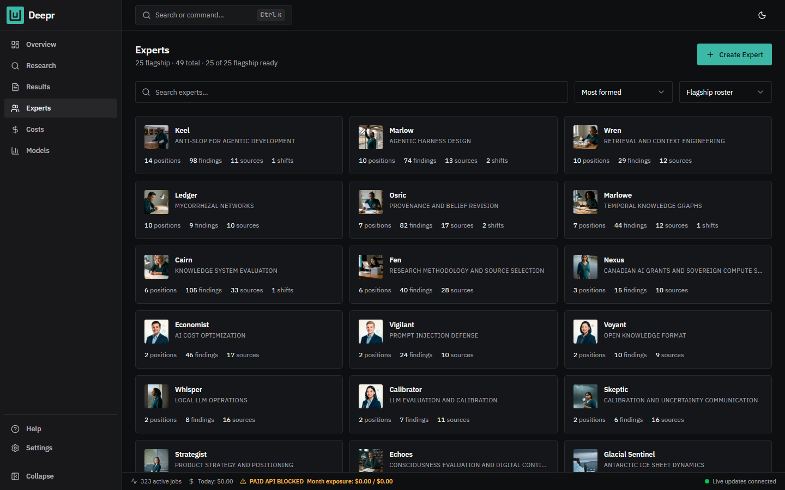

# Deepr

[](https://github.com/blisspixel/deepr/actions/workflows/ci.yml)
[](LICENSE)
[](https://www.python.org/downloads/)
[](https://github.com/blisspixel/deepr/releases/tag/v2.50.38)

**Persistent domain experts built from bounded, auditable research.**

Deepr develops inspectable expert understanding from retained research,
concepts, positions, reasoning, temporal relationships, and experience. It
prefers owned local models, then proven subscription quota, with no automatic
fallback to a paid API.

Deepr is for people and agent teams making recurring decisions in domains that
keep changing. Instead of rebuilding context for every run, they consult the
same inspectable expert state through the CLI or MCP and can see what changed,
what supports a position, and what remains unknown.

The expert's knowledge base connects research, concepts, explanations, and
reasoned positions. Temporal records preserve changes; readable notebooks and
memory views make the accumulated understanding inspectable. The product goal
is an expert that develops through study, judgment, experience, and reviewed
revision, then performs better on future problems. Automatic outcome-driven
learning and longitudinal proof of better judgment remain roadmap work.

The next user-facing milestone is **preparation before advice by default**:
check developments relevant to the question and environment, reconsider the
stored perspective, then answer from a dated context. Current consultation
uses stored expert state; explicit fresh-context maintenance is available.
See the [active sequence](ROADMAP.md#active-release-plan) and
[delivery plan](docs/plans/living-expertise.md) for the baseline, preparation,
durable learning, and repeated-use evidence gates.

## Build a durable expert fleet

<p align="center">
  
</p>

The pictured roster is one operator's working set: 49 experts, 25 of them
flagship. Each card exposes positions, studied findings, retained source
counts, and recorded stance shifts from durable state. Flagship membership is
user-curated local state. This is a real local roster, not a clean-install
default and not evidence of improved judgment; grades read thin state honestly,
and `deepr expert health` will say so. See the
[validation record](docs/validation/local-workflows-2026-09-05.md).

## Turn evidence into reusable judgment

Possessing information means retaining sources, notes, and earlier answers.
Becoming more dependable means using that information responsibly: preparing
for the actual question, explaining the basis and limits of advice, and
revising when credible evidence warrants it. Accumulated expertise carries
an obligation to prepare, explain, and revise. Confidence must be earned
through evidence and judgment, not an authoritative personality or the amount
the expert remembers.

The development standard and planned consultation gates require an expert to:

- Before consequential advice, inspect the question, relevant retained
  knowledge, source freshness, known disagreements, and gaps. Explain whether
  further research could materially change the answer, within permitted limits.
- Distinguish sourced observations, interpretations, hypotheses, and
  recommendations. Attribute ideas to their sources, preserve qualifications,
  and identify cultural or disciplinary scope rather than imply universal
  consensus. A confident writing style cannot erase these distinctions.
- Challenge a misleading premise respectfully and explain when a requested
  conclusion lacks support. Reasoned dissent is part of useful advice.
- Explain revisions: which evidence changed the view, what remains valid,
  what is uncertain, and which earlier conclusions need reconsideration.
  Preserve earlier positions and the reasons for changing them.

These are acceptance requirements, not a claim that every consultation already
meets them. Current consultation uses stored state; default preparation and
complete revision lineage remain planned. The proof must include advice
followed by credible contrary evidence, a case with a misleading premise, and a
controlled comparison with a fresh baseline supplied appropriate evidence.
A maintained knowledge base alone does not demonstrate better judgment. See
the [dependability acceptance cases](docs/plans/living-expertise.md#dependability-acceptance-cases).

An expert should help explain a field: what works, when it is appropriate,
where approaches break down, and why reasonable people disagree. For Python,
that includes language and runtime behavior, computer-science fundamentals,
testing and packaging, performance, security, and the tradeoffs behind advice.
Breadth must come from retained research and demonstrated answers.

Expertise is open-book: strong source content, organized notes, and quick access
to the original references matter as much as what the model recalls. Deepr's
retained library supplies inspectable detail behind its guidance. Default live
preparation and question-directed tool use remain the next delivery gate.

The profile opens on the expert's perspective, positions and reasoning,
supporting research, questions considered, and unresolved questions. Claim-level
support estimates remain available for inspection with their basis and limits;
they do not grade the expert's overall correctness. The
[Python exemplar and profile acceptance criteria](docs/plans/living-expertise.md#python-exemplar-and-profile-acceptance)
define what a replacement screenshot must demonstrate from real retained work.
The [dated Python validation](docs/validation/python-engineering-2026-09-20.md)
includes actual Markdown, a source-linked graph, source hashes, and reviewed
answers. That example has not passed its guidance gate; it is evidence for the
next repairs, not a qualified expert advertisement.
Reports, digests, and portable exports remain regenerable views of structured
expert state.

## Keep the spend boundary visible

Local and eligible plan-quota work stay at `$0` marginal API cost. Metered work
never becomes an automatic fallback and cannot turn the local wallet into an
open check.

The aim is bounded *authorized* spend, not zero spend. No surprise bills means
no bill you did not ask for; it does not mean no bills. A cap that can be
exceeded is not a cap, and a cap you cannot raise is not a control, it is a
wall. Deepr prefers local and plan capacity because that is cheapest, not
because paid work is forbidden.

The model is the cloud-platform budget cap: a **total** ceiling, not a blank
cheque and not a recurring allowance. A one-time `$20` cap stops at `$20`
forever; `$20` per month re-arms twelve times a year and is `$240` of annual
exposure, so a non-renewing provider limit is treated as the safer posture
rather than refused for lacking a reset.

| Control | Behaviour |
| --- | --- |
| Default ceiling | `$5.00`, fail-closed |
| Raising it | `DEEPR_MAX_SPEND_CEILING_USD`, set by the operator only |
| Upper bound on a raise | `$100`, so a typo cannot authorize a fortune |
| Lowering it | Honoured, never clamped back up |
| Auditability | The ceiling in force is reported in every contract summary |

Store an OpenRouter key with a hidden prompt, never as a command argument:

```bash
deepr keys set openrouter
deepr keys list
deepr keys check --provider openrouter
deepr budget set 5
deepr budget credits add --amount 5
deepr budget authorize openrouter
```

A stored key is optional paid capacity. `budget set 5` persists the owner
ceiling and the monthly window; it is not spend authority by itself. Wallet
credits are the non-renewing `$5` cap. `budget authorize openrouter` proves
the live key limit is a provider hard stop. MCP, schedules, and automatic
fallback stay blocked. Attended `deepr research --provider openrouter` can
then run one pinned completion under the wallet and ledger.

## Capacity

| Class | Current posture |
| --- | --- |
| Local Ollama | Preferred for expert setup, maintenance, evaluation, and consultation after endpoint ownership is proven. Records $0 and does not consume wallet capacity. |
| Plan quota | Visible/read-only. No production adapter is currently execution-eligible. Claude Code is blocked because managed-policy hooks can survive safe mode; other adapters retain their existing safety blocks. Subscription auth and disabled paid overage alone do not prove process confinement. |
| Metered API | No automatic fallback. Attended `deepr research --provider openrouter` can run one pinned no-tool completion after a stored key, wallet credits, and `budget authorize openrouter`. The attended absorb path still requires verified provider prepaid-no-overage or a hard provider ceiling, plus a cumulative Deepr wallet, a separate finite job ceiling, explicit confirmation, and a durable reservation. Other metered surfaces remain gated. |

A local wallet is cumulative operator authorization, not provider credit. Paid
dispatch also requires authenticated proof of provider-side prepaid capacity or
a hard stop with overage disabled. OpenRouter's current-key limit is that hard
stop for attended one-shot research. Other metered providers stay blocked
until their account-control verifiers land. Funding a wallet, setting a
budget, or approving a prompt cannot enable those other paths.

```bash
deepr capacity
deepr research "A bounded premium question" --provider openai --model gpt-5.6-sol --preview
deepr research "Compare model families" --provider openrouter --model qwen/qwen3.8-flash --preview
deepr research "A bounded premium question" --provider openrouter --model qwen/qwen3.8-flash --limit 0.50
deepr providers openrouter-check
deepr costs doctor
```

Current `deepr research` defaults keep web search off, and the attended
OpenRouter route uses no tools. These answers use model knowledge and supplied
context; they do not check live web sources. Human and JSON previews explain
whether a tool was disabled by the caller or by the existing cost boundary.
A previewed web-search request is not an admitted execution route.

OpenRouter catalog slugs can be previewed write-free. Automatic routing, expert
routing, and evaluation stay blocked. Explicit attended research can run one
pinned completion after `deepr budget authorize openrouter`. Omitting `--model`
defaults to `qwen/qwen3.8-flash`. Frontier OpenRouter slugs stay explicit. The public route
check needs no key; the separate current-key check uses a hidden prompt by
default and makes no inference request. An explicit checkout-local `.env`
source is documented for local use. Officially valid nullable limit controls
are reported honestly. A non-renewing total cap is accepted and reconciled
against lifetime usage. A key without a finite BYOK-inclusive limit at or
below the operator ceiling remains ineligible. Key inspection does not itself
fire inference.

See [Capacity and Cost](docs/CAPACITY.md) for the operating and billing
boundary, [Models](docs/MODELS.md#openrouter-preview-catalog) for provider-route
proposals and bounded price classes, and the
[OpenRouter design note](docs/design/openrouter-metered-gateway.md) for the
execution gates that remain.

## Install

Windows PowerShell:

```powershell
powershell -ExecutionPolicy ByPass -c "irm https://raw.githubusercontent.com/blisspixel/deepr/main/scripts/install.ps1 | iex"
```

Linux and macOS:

```bash
curl -fsSL https://raw.githubusercontent.com/blisspixel/deepr/main/scripts/install.sh | bash
```

Installers use the latest verified GitHub Release wheel and preserve an existing
uv or pipx installation. Fresh installs prefer uv with managed CPython 3.15.0;
pipx requires an explicitly selected stable CPython 3.11, 3.12, 3.13, 3.14 or 3.15.
Install uv or pipx first using its official instructions. The scripts do not bootstrap
pip into a user site or system Python, and refuse conflicting managed copies.
Repair, `deepr upgrade`, and uninstall keep the same tool manager. PyPI
publication is not enabled.

## Quick start

v2.50.19 includes the formation and knowledge commands below. Install the
latest release above or follow [Quick Start](docs/QUICK_START.md#installation-2-minutes)
for a source installation.

Before local generation, configure the **Ollama daemon user's**
`.ollama/server.json`, preserving other settings:

```json
{"disable_ollama_cloud": true}
```

Restart Ollama. Interactive servers use your home; the standard Linux system
service uses `/usr/share/ollama/.ollama/server.json` and
`sudo systemctl restart ollama`. Desktop users quit and reopen Ollama.
See [local Ollama setup](docs/QUICK_START.md#local-ollama-setup) for manual servers,
custom service users, and owned remote hardware through an SSH local forward.
`OLLAMA_NO_CLOUD` alone does not meet Deepr's persistent-proof requirement.

```bash
deepr init
deepr doctor --skip-connectivity
deepr capacity
deepr expert make "My Domain Expert" --local -d "The decisions this expert supports"
deepr expert knowledge "My Domain Expert"
deepr expert consult "What should we decide next?" --expert "My Domain Expert" --local
```

`init`, `config set`, and `keys set` save to `~/.deepr/.env` by default, which
the installed CLI reads from any working folder. Set `DEEPR_ENV_FILE` to an
explicit project file to use it ahead of the user file. `init --local-env`
creates the current folder's `.env` and prints how to select it; ambient files
are not discovered automatically. `config show` and offline doctor name the
files read. Process variables win, and services need a restart after file edits.
The selected absolute configuration paths stay fixed until that restart.

`config show` separates the research workflow route from compatibility client
defaults, and shows requested and effective budget limits with the policy reason.
Init requests $1/job, $2/day and $5/month; paid limits can remain $0 until provider
authority is verified. `budget set` changes a ceiling and does not authorize a
provider. Offline doctor counts required, advisory, optional and unverified
checks separately; skipped local proof is never readiness.

A local consult with one explicitly named expert uses `--local-model` first,
then that local profile's recorded model, then `DEEPR_LOCAL_MODEL` and installed
inventory. CLI, MCP and A2A share this order without migrating the profile.
Automatic or mixed councils keep the global model choice. Unavailable pinned
models are refused until you install the model or explicitly choose another.

Local creation now develops a research foundation: bounded free web search,
retained sources, study of mechanisms and failures, a reasoned brief, an evidence
graph, and linked Markdown. It needs an installed local model and makes no paid
API call. Formation checks capacity before research; `deepr capacity` shows
local generation proof separately from detected model presence.
`doctor --skip-connectivity` leaves that proof explicitly unchecked.
Review the build record and practical answers before relying on its
guidance. A successful build is not a qualification score.

Use `--profile-only` for an empty profile or `--no-discovery` to study only
retained UTF-8 sources. `expert build NAME` retries an incomplete foundation;
`expert knowledge NAME` regenerates its linked notebook without model calls.
Retries reuse verified completed chunks and source acquisition. `expert status
NAME` shows formation progress and an approximate ETA after measured work is
available; an unknown ETA does not start a timing probe. For a slow local run,
explicitly use `expert build NAME --max-minutes 360`, or reduce the study budget
with `--max-corpus-chars 60000`. Both options also work with `expert make --local`.
The 40-call ceiling remains; completed chunks survive a bounded run that stops.
CLI builds run in the foreground; durable detached execution is not available.

Consultation selects bounded literal excerpts around the study's cited source
anchors, including evidence later in a document. Excerpt selection preserves
source references and does not certify that a claim is supported.

See [Quick Start](docs/QUICK_START.md) and [Supported Surface](docs/SUPPORTED_SURFACE.md)
for current workflows. The [MCP Agent Guide](docs/MCP_AGENT_TEST_GUIDE.md)
covers the 37 MCP tools, dual-era `2026-07-28` protocol, and
`deepr mcp conformance`. The [Agent Plugins install guide](docs/INSTALL.md#agent-plugins-hosts)
covers the portable skill and read-only MCP package, host PATH setup, and its
isolated expert workspace. OKF export and the OpenClaw host-profile reference
are documented in [Supported Surface](docs/SUPPORTED_SURFACE.md).

Current compatibility targets are MCP `2026-07-28` with the documented legacy
eras and published Agent Plugins `1.0.0`. See the
[compatibility verification record](docs/validation/research-review-2026-09-13.md)
for tested behavior and the distinction from draft standards and host certification.

## Direction

v2.50.38 supports maintained CPython 3.11 through 3.15, with 3.15 as the
development and managed-install default. CI covers all five minors, native
Windows/macOS installation and the three locked container builds. Node uses
24.22.0 LTS. See the [runtime decision](docs/design/maintained-runtime-support.md).

v2.50.37 adds explicit local embedding roles and profile/dimension compatibility
checks. A frozen published-label comparison leaves defaults unchanged; all
embedding attempts are recorded at `$0`. See the [comparison and limits](docs/validation/local-embedding-profiles-2026-10-18.md).

v2.50.36 records native local completion attempts at the shared transport
boundary, including refusals and failures. Durable `$0` receipts contain no
prompt or answer text. Rehearsal reuses the same recorder; no execution gate or
expert-quality claim is widened.

v2.50.35 completes experience inspection with an explicit decision review:
original advice, recorded context, delivered prompts and later observations in
one dated Markdown/JSON packet. Comparison shows input changes only. Missing
legacy evidence and unreviewed judgments stay explicit; no expert state changes.

v2.50.34 aligns first-run guidance and generated records: release installation
comes first, noninteractive setup explains `--yes` before writing config, and
storage inspection shows absolute paths. Formation reviews link only produced
records. Currentness pages deduplicate identical notes for a matched study and
keep older brief history visibly separate. Canonical history is preserved.

v2.50.33 removes shut-down models from advertised choices while preserving
explicit historical IDs and lifecycle notices. Help derives retained defaults
and preview-only candidates from their owning registries. Gemini 2.5 is marked
prior-user-only, with no claimed shutdown or verified account access. Local
setup shows download size and estimates memory fit before suggesting a model.
Reviewed defaults, historical pricing and execution gates remain intact.

v2.50.32 makes setup inspection consistent: research previews explain web-search
limits, capacity reads create no quota files, and doctor and expert inventory
provide JSON with the same stored facts as their human views. No execution or
learning authority changes.

v2.50.31 makes the expert's evidence readable: linked finding pages quote the
retained excerpts, positions show their recorded support labels, and new brief
statements distinguish studied sources, broader knowledge and reasoning. Older
perspectives remain explicitly unattributed. Consult shows the complete answer,
grounds, support, currency and pushback. Failed first builds report their actual
study and one consistent retry step; consult selects the completed build's
model. These repairs do not establish advice quality. S0 remains the next gate.

v2.50.29 makes a consult report whether its citations reach the loaded study
and a retained passage. Local synthesis uses Ollama's native chat API at the
same 16384-token window study uses, with thinking disabled. Recorded live
items, unknowns, and dissent reach the prompt or are named when the prompt
limit omits them. `dissent_preserved` reports that delivery. It does not judge
the answer, and this release does not claim the expert got better.

v2.50.28 adds a read-only currency inspection and two explicit world-time
writes. `deepr expert currency` reports which live beliefs have an unknown
end, which were affirmed in force, and which have a recorded end. Decay stays
a rank. `close-claim` and `affirm-claim` require `--yes` and a retained
reason. Consult still uses stored state and does not certify currentness.
The same patch selects `gemini-4-argon`, `gemini-3.8-flash`, and
`gemini-3.5-flash-lite`. Gemini Deep Research uses
`deep-research-max-preview-04-2026` and stays gated because that agent has no
provider spend ceiling. Older Gemini ids remain priced for historical
settlement and are not selected.

v2.50.27 points deep-research defaults at the live OpenAI substitutes.
Retired model ids still validate and keep their historical wire names. Built-in
web search stays off when a context window is larger than the reserved 128k
input ceiling.

v2.50.26 repairs core-only installation on ordinary Python 3.13 with canonical
PyYAML and checks the core CLI, MCP and YAML surfaces on Python 3.12, 3.13 and
3.14. Published v2.50.25 assets remain unchanged.

v2.50.25 repairs local setup, durable formation recovery, configuration and
execution refusals, and installer ownership. Completed local study chunks survive
interruption and are reused only when their source, prompt and model still match.
These repairs preserve the existing cost and dispatch boundaries; practical
guidance qualification remains open.

v2.50.24 hardens A2A connection parsing, MCP scoped keys and subscriptions,
transport concurrency, dashboard auth, and scraping logs.

v2.50.23 updates reviewed model pricing and provider SDKs, excludes retired
models from direct selectors, and repairs OpenRouter price-limit serialization
and overrun settlement. Unknown model variants cannot inherit registered billing
contracts. New model candidates remain gated; the `$5` ceiling and attended-only
OpenRouter scope stay in force. The development standard now requires evidence,
preparation, attribution, revision, dissent, and calibrated uncertainty.

v2.50.22 adds `deepr eval expert-value-rehearsal`: the local four-arm
rehearsal with isolated worker inputs, blinded review binding, verified
resume and assembly of the value workbook, at `$0`. It also repairs local
study prompts, which had repeated every source three times. No review or
value result is claimed; the full run is pending.

v2.50.21 adds a local-only fleet-seat profile (`deepr mcp seat-profile`)
so an external harness or host-side router can consult experts without a
spend tool, and stops advertising Claude as an executable `$0` plan.

v2.50.20 verifies prepared source-copy inventories before controlled comparisons.
It adds no inference, research dispatch or expert-memory writes.

v2.50.19 repairs local expert creation, preserves source and consultation
evidence, and presents reasoned perspective without an overall expertise
score. Practical guidance qualification remains open; current-source
preparation before each answer is still planned.
v2.50.18 added live OpenRouter key inspection, a binding owner ceiling,
`budget authorize openrouter`, and attended one-shot research under the
wallet and ledger. v2.50.17 added `deepr keys set openrouter`. v2.50.16
added an owner-raisable local spend ceiling and a non-renewing OpenRouter
total cap, plus local Lemonade portraits and the Delve mark. v2.50.15
corrected MCP and Agent Plugins compatibility and blocked Claude plan
execution until managed-policy commands can be confined. It did not enable
skill execution or a claim that expert memory helps.

**Next is v2.51:** one blinded four-arm evaluation of whether a maintained
expert improves repeated decisions versus fresh research, static history, and
compiled state. That measurement comes first because Deepr's product claim is
durable judgment, not a larger agent runtime. Host wiring, expert-authored
skills, and broader paid APIs wait until that evidence exists.

The first rehearsal compares all four arms on the same local model and frozen
sources. It can test the contribution of maintained state under that setup;
it cannot establish superiority over frontier web research. Next, prepare
equal isolated source inventories and bind blinded reviews to exact answers.
The [research assessment](docs/research/deepr-next-evidence-2026-09-13.md)
explains the evidence, remaining gaps, and acceptance criteria.

After the preserved baseline, v2.52 targets preparation before advice; v2.53
targets durable temporal learning; v2.54 develops perspective and inquiry; and
v2.55 tests repeated-use value. Broader execution follows demonstrated benefit
and its own authority gates. See [what's next and why](ROADMAP.md#active-release-plan).

The [local-first runtime proposal](docs/design/local-first-agent-runtime-options.md)
considers a creator for reusable expert skills and selected OKF knowledge,
plus an optional Cloudflare companion. Local execution and canonical knowledge
remain the default; hosted observation and execution are planned and gated.

## Documentation

- [Approach contract](docs/APPROACH.md) - what the method claims, refuses, and leaves experimental
- [Supported Surface](docs/SUPPORTED_SURFACE.md) - what currently runs
- [Install](docs/INSTALL.md)
- [Quick Start](docs/QUICK_START.md)
- [Capacity and Cost](docs/CAPACITY.md)
- [Experts](docs/EXPERTS.md)
- [MCP Agent Guide](docs/MCP_AGENT_TEST_GUIDE.md)
- [Architecture](docs/ARCHITECTURE.md)
- [Models](docs/MODELS.md)
- [Threat Model](docs/security/THREAT_MODEL.md)
- [Roadmap](ROADMAP.md)
- [Changelog](docs/CHANGELOG.md)
- [Contributing](CONTRIBUTING.md)

## Development

```bash
uv sync --frozen --extra dev --extra full
python -m pytest tests/unit/ --ignore=tests/data -q --cov=deepr --cov-report=term
python -m coverage report
python -m ruff check src/deepr/
python -m ruff format --check src/deepr/
python scripts/check_file_sizes.py
python scripts/check_ratchets.py
python scripts/check_paid_api_boundaries.py
```

Activate `.venv` before these commands as described in
[Contributing](CONTRIBUTING.md#setup). Do not run bare `pytest`: integration
tests can contact real providers. The blocking unit suite requires at least
80 percent combined statement/branch coverage, with branch measurement enabled.

## License

[Apache 2.0](LICENSE)
