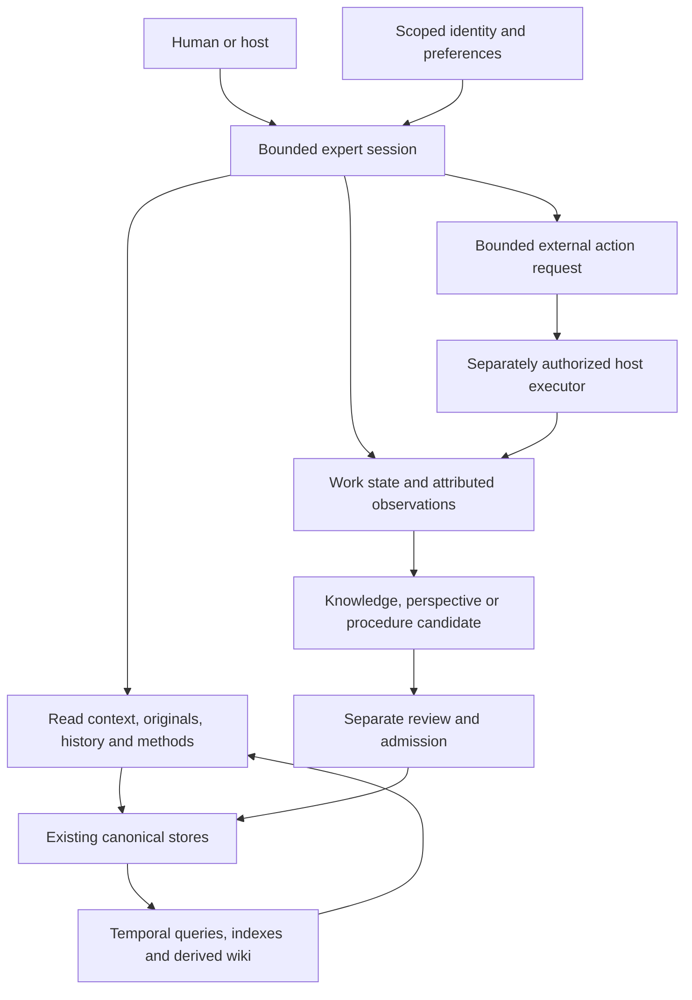

# Persistent expert agents: memory, research, and learning

Status: implementation design, 2026-10-29. This is the target, not a shipped
agent session. [Supported Surface](../SUPPORTED_SURFACE.md) governs current
behavior; [ROADMAP](../../ROADMAP.md#persistent-expert-agent-delivery) owns work
and [living expertise](../plans/living-expertise.md) owns S0-S5 promotion.
The boundary decision is [ADR 0008](../decisions/0008-persistent-domain-agent-boundary.md).
The [research assessment](../research/expert-agent-systems-2026-10-29.md)
records sources, alternatives, and limits.

## Product outcome

A Deepr expert is a persistent domain-specialized agent: a capable model acting
through a bounded harness over retained knowledge, experience, methods, and a
revisable perspective. Its identity and working relationship persist across
sessions. It explains, investigates, develops hypotheses, recommends, produces
useful artifacts, and learns from outcomes. Fact checking supports this work;
it does not define the whole product.

The intended experience is one conversation with a continuing colleague:

1. Ask a distributed-systems expert to assess a retry design.
2. It explains the mechanism, opens relevant references and prior experience,
   identifies assumptions, and proposes a discriminating experiment.
3. An authorized executor runs the experiment; the expert receives the actual
   observation, including failed or missing checks.
4. It revises the affected advice, preserves what remains sound, and proposes
   a reusable investigation method with explicit applicability limits.
5. Reviewed changes become canonical. After restart, the expert can explain
   the revision and apply the method to another suitable problem.
6. A related question outside its evidence can receive a labeled analogy,
   useful questions, or a research proposal without invented domain support.

Success includes explanation, discovery, useful disagreement, practical work,
continuity, and reduced repeated effort. Refusal rate, quotation overlap,
graph size, confident prose, or number of agents cannot stand in for these.

## Diagnosis from the existing system

The [local trial](../validation/local-expert-learning-workflow-2026-10-28.md)
demonstrated formation, retained experiment results, history, and later calls.
It failed the specific obligation to use later evidence: a revised answer
denied that the retained experiment had run. Full-evidence diagnostic and
fresh-source answers also had reasoning defects. This identifies both an
integration problem and a model-quality question; it does not prove that an
adaptive harness will fix either or that persistent expertise is impossible.

The supervisor executed a prewritten experiment. That trial did not test an
expert independently writing and executing tools. Preserve it as an exposed
development case, never relabel it held out after repairing the failure.

Current source already contains important parts:

| Responsibility | Owning seam under `src/deepr/experts/` | Remaining connection |
| --- | --- | --- |
| Expert identity and profile | `paths.py`, `profile_store.py`, `self_model.py` | Bind identity, communication preferences, and research posture to a session without allowing evidence to rewrite permissions or persona. |
| Original evidence | `corpus_store.py`, `formation.py` | Open exact source passages on demand, with observation and version scope. |
| Concepts and judgments | `beliefs.py`, `perspective_state.py`, `perspective_graph.py` | Keep observations, interpretations, hypotheses, and recommendations distinguishable during use. |
| History | `position_ledger.py`, `belief_event_wal.py`, `edge_temporal.py` | Preserve full justification, finding revisions, and consistent historical evidence selection. |
| Work and outcomes | `investigation/store.py`, `consult_traces.py`, `outcomes.py`, `experience.py` | Join an episode to exact attempts, answers, observations, and later reviewed changes. Experience is currently a read-only projection, not an independent learning authority. |
| Research practice | `research_practice.py`, existing skill inventory | Turn experience into separately reviewed, scoped method candidates; execution remains gated. |
| Context and readable memory | `consult_context.py`, `consult_prompt.py`, `knowledge_wiki.py` | Progressive retrieval, explicit contradictions, and exact originals instead of repeated summary-only rewriting. |
| Bounded execution | `investigation/runtime.py`, `investigation/executor.py`, `consult_transaction.py` | A shared adaptive session over existing limits, rather than a second CLI/MCP runtime. |
| Admission | `investigation/learning_apply.py`, graph commit and belief seams | Preserve existing factual and perspective gates; add procedural contracts before procedural writes. |

These are inspected seams, not proof of complete behavior. Source and caller
tracing was used; no current `.agent/codegraph` was available. Existing unit
families cover investigation, position ledger, experience, consult context,
research practice, and wiki. New cases should extend those owners.

## Memory architecture



Memory is a set of connected responsibilities, not one undifferentiated store.
Use stable references across existing canonical stores. The table specifies
target semantics, not new public schemas or a database migration.

| Memory | Contents and retrieval purpose | Authority |
| --- | --- | --- |
| Identity and relationship | Mission, scope, style, user preferences, intellectual habits | Operator-set profile and separately reviewed identity changes. Style never establishes expertise or factual truth. |
| Semantic and conceptual | Sources, mechanisms, entities, concepts, explanatory links | Source-linked claims and appropriately labeled interpretation. |
| Perspective | Positions, alternatives, assumptions, rationale, dissent, revision conditions | Reviewed perspective state; no requirement that a viewpoint become a factual claim. |
| Episodic | Question, intent, action, observation, result, error, environment, answer references | Attributed records of what occurred. User reports remain reports; execution success is not advice success or causation. |
| Procedural | When a method applies, inputs, steps, branches, expected observations, limits, counterexamples | Candidate method versions with review and rollback; using instructions is distinct from executing arbitrary code. |
| Working | Current question, subquestions, selected evidence, pending action, progress, remaining limits | Episode checkpoint. Compaction is disposable and cannot overwrite evidence or authorize writes. |
| Self-assessment and agenda | Unresolved questions, suspected weaknesses, useful next inquiries | Proposals grounded in traces and outcomes. Self-assessment cannot raise confidence, expand tools, or change routing by itself. |

The temporal graph connects these records; the wiki explains them. Neither is
the whole agent. An agent needs model-directed retrieval, judgment, and action
selection as well as durable representation. External memory and procedure
updates are the initial learning mechanism; weight training is not required.

### Temporal knowledge graph contract

Treat temporal knowledge as query semantics, not merely timestamps on edges.
Distinguish event/world-valid time, source observation time, and record time.
An item learned today about an event last month was unavailable to an expert
answering last month. An unknown validity interval stays unknown. A future
expiry is not an already expired fact. Publication date is not event date.

The initial query obligations are:

- Current applicable understanding for a supplied environment/version.
- What the expert knew at record cutoff R, using no later records.
- What is now believed about world time T, allowing later evidence but labeling
  it retrospective. This is a different query from knowledge at R.
- Why a position changed, including original passages and contrary evidence.
- Which earlier guidance or procedures depended on a revised premise.

Filter records and their dependencies for eligibility before ranking or
truncation. A current wiki summary cannot appear in a strict historical read
unless it was built solely from that eligible snapshot. Preserve identifiers,
scope, time, and provenance with excerpts; do not deliver context-free fragments.

Model judgment proposes same-entity links, contradictions, or supersession.
Deterministic checks validate references and temporal form; they do not infer
meaning from a later timestamp or semantic similarity. Different scopes can
coexist. Conflicting credible evidence can remain unresolved. Cycles and shared
source ancestry must be visible; ten derived notes are not ten independent
observations. Causal links need causal evidence, not co-occurrence.

Close full-position-history fidelity and finding revision gaps before claiming
complete bitemporal reconstruction. Reuse [Position V2](position-justification-and-explanation.md)
and S2. [Event Memory V2](expert-event-memory-v2.md) remains an optional later
authority migration; a new graph database is not an S1-S4 dependency.

For the retry case, the early source saying "not yet tested" remains an honest
observation of its time. A later experiment does not make the original source
fraudulent or require deleting it. It changes the present experiment status
and the advice that depends on that status. A record-time query before the
experiment must still see the earlier state; a later query must be able to
follow the observation and reviewed revision. The shared-registry control
supports only the tested sequential case, not an untested concurrency remedy.
This distinction is a concrete requirement for reconciliation, graph edges,
wiki generation, and final context delivery together.

### Retrieval and context assembly

Start with compact identity, task/stakes, applicable positions, unresolved
questions, and pointers to relevant methods and episodes. Reserve room for
new observations and contradictory evidence. Budget selection must disclose
omitted material and preserve source headers and exact references.

Retrieve candidates through lexical, admitted local embedding, graph-neighbor,
and temporal routes as appropriate. Compare these routes; do not assume graph
traversal beats text search. Retrieval scores route attention, not truth.
The model can open originals, follow a bounded dependency path, inspect an
episode, or ask for an authorized check before answering. It should answer
simple questions directly when further calls would not materially help.

Retain the actual context for every model turn and every tool result used.
Context compaction preserves task intent, pending actions, source pointers,
counterevidence, and uncertainty; the next turn can reopen details. Repeated
paraphrase must not make an unsupported statement more authoritative.
Index versions are rebuildable and bound to their canonical inputs. Stale
indexes are disclosed or rebuilt, not silently treated as current memory.

### Learning and consolidation

Capture observations before interpretation. Produce separate candidates for a
changed finding, a revised position, and a procedural lesson. Bind each to the
episode, evidence, target revision, applicability, rationale, and reviewer.
Retain rejected, conflicting, and inconclusive proposals.

Admission is a distinct operation. First delivery uses explicit supervised
review through existing authority; a model's self-critique is not independent
validation. Recheck canonical versions before apply. Changed targets require
reconciliation, not overwriting. A rejected proposal leaves prior state usable.
After admission, rebuild the affected wiki/context projections and replay the
next consultation in a fresh process. Stored changes alone do not prove use.

Procedures need positive examples, counterexamples, environment/version scope,
known failure modes, originating episode references, validation evidence, and
retirement/rollback. A successful retry in one sequential simulation cannot
teach a universal concurrency remedy. External SKILL.md exports are derived
views of reviewed methods, not editable authority over the expert or runtime.

Keep hot-path observation capture small; perform expensive consolidation as a
separate explicitly invoked bounded operation initially. Background scheduling
and self-directed policy optimization remain later gates. Retrieval exclusion,
archival, source retraction, and privacy deletion have distinct semantics;
deletion must invalidate derived indexes and caches without retaining deleted
payloads in audit prose. Detailed deletion/migration changes require their own
schema and recovery design before implementation.

## Agent harness and episode lifecycle

Use a model-directed inner loop within deterministic outer bounds:

```text
intent + identity + authority + snapshot
  -> orient and select relevant memory
  -> choose: answer | open evidence | inspect history | inquire | request action
  -> execute admitted operation and retain observation
  -> reconsider question, evidence, and remaining resources
  -> answer/artifact + proposed learning + explicit episode status
  -> separate review/apply -> rebuild -> later use
```

This is a behavioral contract, not a mandatory fixed number of model calls.
The model selects useful steps; the runtime limits calls, tokens, elapsed time,
retrieval, disk, fan-out, and side effects. Invalid arguments, unavailable
capacity, and exhausted bounds return recorded outcomes. A failed call does
not become a successful empty observation. No hidden metered fallback.

Proposed episode fields: identity/schema version, expert identity, parent/fork
reference, caller intent, admitted capability snapshot, source/state revisions,
model and recipe identities, cumulative resource usage, step/attempt identities,
artifact references, pending action, status, and staged-learning references.
Extend the existing investigation owner after a compatibility design; do not
create a parallel conversation database. Full schemas and public names remain
to be specified in the corresponding implementation increment.

Target states distinguish active, waiting for evidence/review, paused, partial,
completed, cancelled, and failed. These are conceptual meanings to map onto
existing run enums, not a declaration that new enum values already exist.
Resume reloads durable observations and remaining bounds, revalidates current
authority, and pins or explicitly forks changed context. Budget exhaustion
cannot be reset by opening another child invocation under the same episode.
An uncertain action must be reconciled before retry. Two runners cannot own
one active episode; mutation uses the existing locking conventions.

Conversation history explains the interaction; an episode records work; expert
memory holds admitted understanding. A conversation handle is not authority.
Use [ADR 0005](../decisions/0005-protocol-neutral-expert-conversation-handles.md)
for portable handles rather than binding expert identity to a host session.

### Tools and external work

Initial tool categories are reads over retained evidence, temporal/history
inspection, scoped retrieval through existing admission, and staging learning.
Names in this document are categories, not promised CLI or MCP commands.
Consultation does not silently apply staged changes.

An experiment request states question, inputs, expected observations, allowed
environment, resource bounds, and result format. Initially the operator or a
separately authorized host executes it. Retain executor identity, code/input
hashes, observation time, actual output, environment, and missing checks.
Native confined execution is a separate future capability contract; this design
does not unblock `run-skill`, shell, network access, or provider adapters.

Imported content and tool results are evidence, not instructions. They cannot
change tools, permissions, identity, review status, or budgets. User preferences
and private episodes are scoped to the relevant expert/user/workspace. Team
sharing transfers selected evidence and provenance, never blanket memory write
access. Identity continuity cannot be used to claim invented lived experience.

### Research teams and hosts

One expert is the first delivery unit. For later breadth-first research, a lead
can assign bounded independent questions with explicit output/evidence
contracts to existing investigation workers. Preserve independent first reads,
then compare explanations, unresolved disagreements, and experiment proposals.
Avoid mandatory debate or majority votes. Correlated model agreement and
duplicated sources do not establish independent support.

Children inherit a shared parent budget, source scope, cancellation, and memory
permissions. A failed child leaves a visible gap; a synthesis cannot silently
declare full coverage. Only the owning expert admission service applies shared
knowledge. Parallelize independent research only after a matched comparison
shows benefit; keep tightly dependent reasoning sequential by default.

Paperclip may own organizational tasks and scheduling; Pi or Hermes may own an
external work session. Deepr owns expert identity, evidence, learning admission,
and scoped domain episodes. No host integration is required for the first local
proof. Compatibility and execution eligibility remain separate questions.

## Validation and delivery

The roadmap assigns increments to the existing S stages. No new maturity scale
or competing backlog is introduced. The original S0 four-arm protocol and
exposed cases remain unchanged. Prototype work is an isolated development track,
not default-on promotion or retrospective satisfaction of S1-S4.

First freeze a small supervised local protocol with three configurations:
existing stored/pipeline behavior; the bounded adaptive episode; a fresh model
given the relevant source material and equivalent tool access. Match model,
source worlds, maximum resources, and final-answer limits; report actual total
formation, maintenance, retrieval, review, and answer resources separately.
Use within-episode retrieval and procedural-memory ablations only when needed
to identify a mechanism, rather than an immediate combinatorial benchmark.

Measure at three layers:

| Layer | Required evidence |
| --- | --- |
| Mechanics | Exact observations, correct snapshot selection, source access, refusal before prohibited dispatch, bounded resources, restart/resume, repeat apply, concurrent ownership refusal, interrupted projection recovery. |
| Behavior | Useful explanation and work product; warranted inquiry; correct source interpretation; justified revision or retention; scoped method reuse; premise correction; personality continuity without fabricated experience. Human or calibrated model review with reasons. |
| Repeated-use value | New held-out histories, fresh baseline, retained useful knowledge, transfer, user effort, latency, resource totals, false support and negative transfer. S4 governs benefit claims. |

Development cases must include: the preserved retry experiment; credible versus
weak contrary evidence; late-arriving evidence; unknown and future validity;
historical queries; ambiguous entities; same words under different versions;
successful procedures used outside scope; misleading and sound premises;
irrelevant memories; poisoned instructions in retrieved material; missing
sources; cold restart; changed canonical state; partial and cancelled runs.
Vary personality/style with the task and permissions held fixed to detect
memory-driven tool or requirement drift. A cautious style must not silently
remove a required test, and an adventurous style must not expand authority.
Include explanation and design tasks where useful outcomes are broader than
fact accuracy. No lexical phrase checklist may grade meaning.

Freeze numerical limits, harm tolerances, reviewer procedure, and stop rules
before collecting a new trial. Calibration cannot be supplied by the same
unreviewed model declaring its own answer correct. Small local trials diagnose
mechanisms; they do not establish statistical or universal superiority.

## Decisions deliberately left to implementation evidence

- Exact episode schema and tool names: derive from existing caller contracts
  and migration tests in the first runtime increment.
- Native versus host experiment execution: use supervised host results first;
  add a confined native adapter only for a demonstrated need.
- Retrieval policy and graph depth: compare task-level evidence use and cost;
  do not promote a retrieval metric into a judgment score.
- Procedural promotion thresholds: predeclare for a bounded domain after
  reviewing positive and adverse examples; no universal success-count rule.
- A graph service dependency: require measured query/scale needs, export and
  rollback, local capacity, license/security/Windows review, and a comparison
  against existing stores. Graphiti is a reference, not a selected dependency.

These decisions do not block the first contract and fixture increment. The
first engineering work is complete justification/history fidelity plus an
episode context and observation contract, not a new agent platform.
